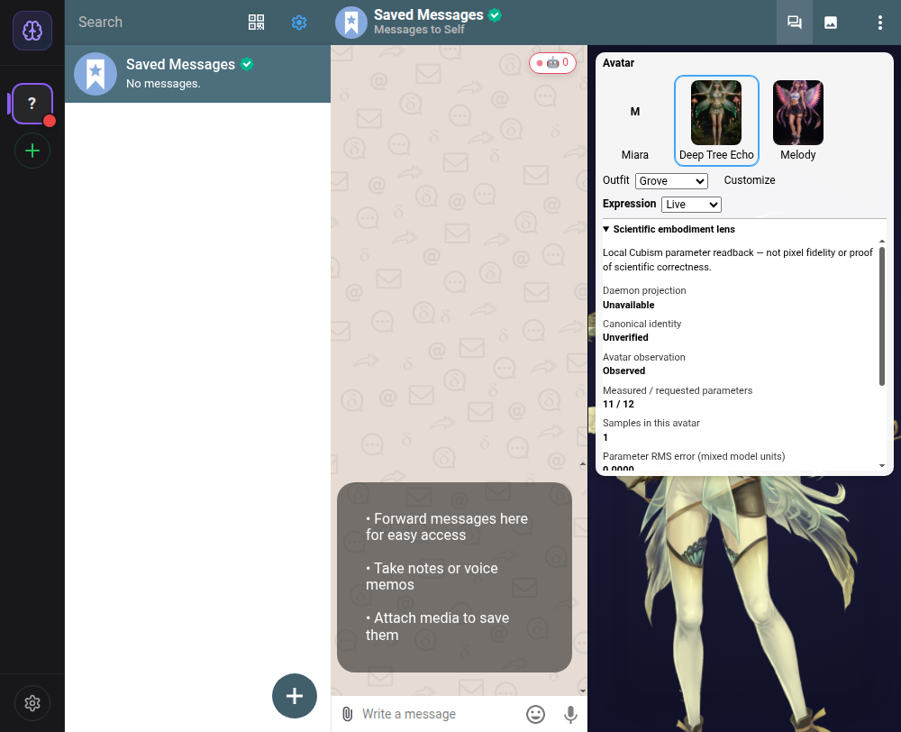

# DTE scientific embodiment lens — 2026-10-10

## Scope and baseline

Base: `37a7ff2901b54211b6277fd7ca028da154a06967` from `o9nn/deltecho-chat/main`. Branch: `manus/scientific-avatar-oct10`.

Deep Tree Echo's intended architecture is a distinctive DAO-like cognitive system with ESN autognosis and a canonical, governed core self. These are architectural commitments, not a claim that this iteration demonstrates AGI, consciousness, scientific correctness or calibrated quorum probability.

This iteration preserves the Delta Chat base, profile isolation, default-off adult presentation rules, canonical governance, existing neural math and deployment configuration. Cloudflare implementation remains paused. No new Lucy artwork/rig is installed; the current DTE model is the previously shipped Cubism distribution.

## Analysis: strongest and weakest integration centers

The `EchoCog/deltechor` foundation separates cognitive packages, desktop composition and mail infrastructure. The current chat repo has these surfaces plus real canonical identity, causal falsification, conceptual metabolism, AIRI presentation boundaries and rendered-parameter self-model feedback. Related user-owned repos were searched using the configured PAT; no foreign source or assets were vendored.

A concise KSM architectural diagnosis:

| Dimension | Local center                                    | Global center                               | Finding / action                                                                                      |
| --------- | ----------------------------------------------- | ------------------------------------------- | ----------------------------------------------------------------------------------------------------- |
| Structure | Cubism parameter IDs, renderer, per-model state | Canonical self, ESN, DAO-like governance    | Unknown Cubism IDs can be virtual cached values rather than rigged controls. Reject them as evidence. |
| Process   | Projection → write → readback → correction      | Autonomy/Entelechy lifecycle                | Anonymous feedback listeners survived stop/rewire. Retain exact callbacks and detach.                 |
| Control   | Finite supported parameter readback             | Governed cognitive projection and proposals | Reject malformed updates before mutation; lens does not vote or grant autonomy.                       |
| Space     | Individual avatar/model lifetime                | Electron renderer versus standalone daemon  | Isolate calibration per manager; do not pretend module singletons bridge processes.                   |
| Time      | Last written target and sample age              | Cached snapshot and bounded event lifetime  | Compare actual writes, refresh embodiment-dependent cache, clear revoked cue/metabolism.              |
| Causality | Measured rig parameter residual                 | Scientific validity and governance evidence | Distinguish parameter evidence from pixel fidelity or hypothesis validation.                          |

The weakest center was **causal evidence closure**, not a lack of new decorative animation. This iteration repairs that center before adding the scientific lens.

## Implemented repairs

### Real Cubism evidence, not synthetic cache echoes

Cubism's actual runtime `getParameterIndex` creates indexes outside `getParameterCount()` for absent IDs; writes/readbacks for these IDs are stored in `_notExistParameterValues`. Such a value never proves an ArtMesh responded.

`PixiLive2DRenderer.getParameter` now requires a finite integer index within the model's real parameter count and a finite value. If membership cannot be established, it returns `undefined`.

The avatar samples only the intersection of supported finite prediction/readback parameters and reports missing coverage. A model with zero measured parameters contributes no experience. It compares against the **last applied composed target**, rather than recomputing time-dependent metabolic/cascade values at sampling time. `ParamBreath` remains excluded from the comparison because it is time-driven.

Learned bias, accuracy and sample count are now per `Live2DAvatarManager` lifecycle; one concurrently mounted avatar or replacement model cannot inherit another's calibration.

### Immediate authority revocation

A missing/uninitialized canonical identity clears the active scientific conductor, not just future triggers. Fresh cascades require initialized identity. When metabolic projection disappears after being present, the manager resets retained metabolic input once. Subsequent neutral animation is local presentation, not evidence of live daemon metabolism.

### Autonomy lifecycle repairs

`wireAvatarFeedback` now requires an `off` capability, retains the feedback source/listener, detaches before rewiring and detaches on stop even before start. Malformed/non-finite numeric updates are rejected before Entelechy, self-modification, virtual-agent state or events mutate.

Accepted embodiment observations refresh `lastSnapshot.scientificGeniusVisual` immediately using the existing snapshot's cognitive inputs. The next visual getter and somatic-marker consumer see the accepted feedback rather than waiting for another snapshot.

No ESN equations, DAO vote logic, mutation grants or canonical acceptance rules were changed.

## Special feature: Scientific embodiment lens

The actual avatar strip now has a collapsed-by-default **Scientific embodiment lens**. It displays:

- Local observation state and last-observation age.
- Measured/requested parameter coverage and unmeasured IDs.
- Sample count for this avatar and raw mixed-unit parameter RMS residual.
- Separate daemon projection availability and canonical anchor status.

The lens is read-only, samples only while expanded, skips hidden windows, disposes subscriptions, pauses under manual expression locking and does not retain a previous model controller as current evidence. It cannot vote, run experiments, mutate identity or grant autonomy. The actual Electron screenshot exposed invalid existing theme tokens; the controls/lens now use the real `bgPrimary` / `textPrimary` theme variables and a readable surface.

It is deliberately available even while scientific mode is idle: it reports missing evidence rather than fabricating "Scientific Genius" activation.

## Validation

| Check                                 | Result                                                                                                                   |
| ------------------------------------- | ------------------------------------------------------------------------------------------------------------------------ |
| Baseline avatar suite                 | 328 tests passed across 24 suites                                                                                        |
| Baseline asset gate                   | 4 manifests, 71 unique nonempty resources, 41,945,889 bytes                                                              |
| Final avatar suite                    | 334 tests passed across 24 suites                                                                                        |
| Focused frontend lens/display         | 43 tests passed across 2 suites                                                                                          |
| Focused autonomy/Entelechy fixtures   | 13 tests passed; orchestrator typecheck passed                                                                           |
| Full workspace test run               | 1,927 passed, 2 skipped; then the one additional metabolic-revocation avatar regression passed in the final avatar suite |
| Repository `check`                    | Passed after restoring missing AIRI workspace dependencies                                                               |
| AIRI localhost broker                 | Typecheck and all 6 tests passed                                                                                         |
| Supported daemon bundle               | Built `dist/bin/daemon.mjs` successfully                                                                                 |
| Product daemon private IPC-only smoke | Bound a private socket, answered a read-only request, SIGTERM exit 0, socket removed                                     |
| Final Electron build                  | Passed                                                                                                                   |
| Browser CI-mode E2E                   | Result recorded in the final delivery report after completion                                                            |

Two initial failures were diagnosed and corrected: the newly merged AIRI broker lacked installed workspace links, and an existing scientific bridge test fixture lacked the new controller method. The frozen lockfile install with pnpm 9.15.0 restored four packages without manifest/lockfile changes. Older Corepack failed signature validation; no signature verification was disabled. Existing Sass deprecations, Jest force-exit advisory and two unused Arrow CLI-link warnings remain warnings, not claimed fixes.

## Actual Electron observation

In sandbox X11 with isolated persistent `DC_TEST_DIR`, existing offline Saved Messages and no outbound message or remote account registration:

- Real DTE Cubism canvas: **347 × 762**.
- Lens measured **11 / 12** requested parameters; **`ParamBodyAngleY` is absent**.
- `JOY_01_BroadSmile` loaded through actual UI; manual locking correctly paused lens observation.
- Two canvas screenshots 1.6 seconds apart changed **28.17%** of pixels at an RGB-channel difference threshold >12: animation evidence, not an FPS benchmark.
- Renderer: **ANGLE SwiftShader**. This is software-rendered Linux evidence, not Windows hardware or GPU-performance evidence.
- With no live daemon, scientific/DAO/ESN fields abstained; the lens displayed daemon unavailable and canonical identity unverified while independently reporting local parameter observations.
- Zero observed parameter RMS residual is not proof of pixel accuracy or scientific validation; direct writes and update ordering can produce a zero residual.

The final rebuilt Electron artifact was reloaded and directly rechecked. The isolated test process was stopped after evidence capture; its retained profile is persistent, but this is not a resident deployed service. The asset gate was also repeated successfully on the final tree.

## Important remaining gaps

1. The actual Electron renderer and standalone daemon do not share module-singleton events. This work does **not** add renderer→daemon feedback transport. The daemon lifecycle repair is proven with in-process integration fixtures, not a newly closed cross-process learning loop.
2. Evidence ordering, renderer/session identity epochs and expiry of accepted embodiment feedback still need a separately specified/tested contract. No freshness/epoch guarantee is claimed here.
3. Raw parameter RMS mixes model units; range-normalized/perceptual error and bounded calibration behavior remain future evaluation work.
4. Lucy still requires authorized separated character art, Cubism deformation/physics authoring and a character-owned `.moc3` export. A UV atlas or Hiyori sample is not Lucy.
5. Real Windows packaging, hardware rendering and standard Delta Chat coexistence were not repeated in this Linux iteration.
6. Existing deployment checks may run automatically on PR creation; they do not mean Cloudflare implementation was resumed.

## Next bounded phase

Specify a private renderer observation contract before connecting any local measured avatar feedback to daemon autonomy: supported-ID coverage, last-applied target identity, canonical anchor, renderer/model epoch, strict ordering, expiry/revocation and a proposal-only governance sink. Review the current AIRI broker for reusable transport components, but preserve its outbound-only pose boundary. Then evaluate range-normalized model-specific calibration and complete the real Lucy art/rig authoring path independently.
