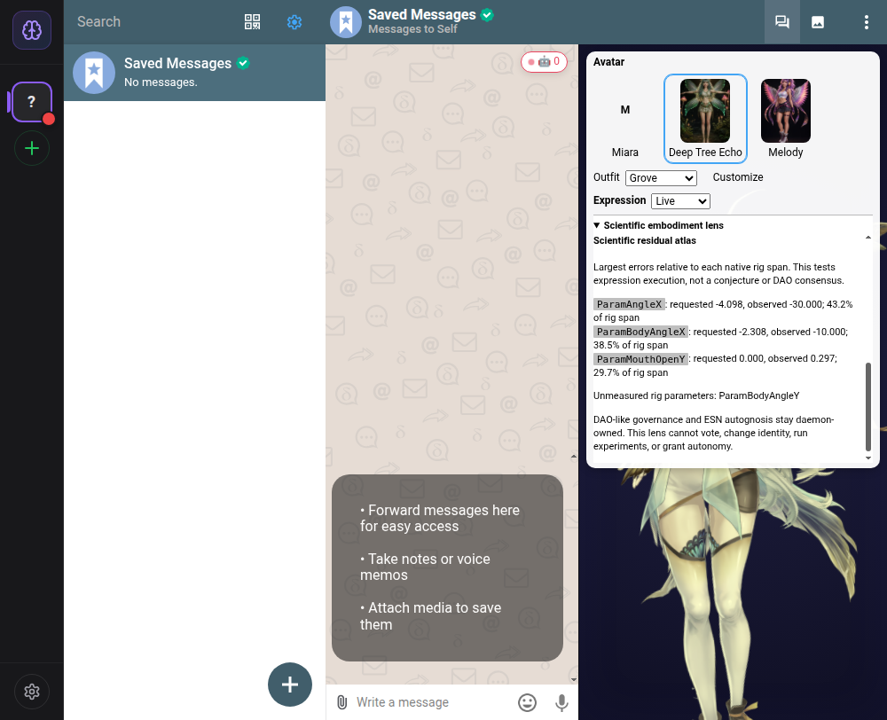

# Native Cubism evidence and governed autonomy — 2026-10-30

This iteration updates PR #92 from current main `ff5458cd`. It strengthens Deep Tree Echo's DAO-like, ESN-autognostic architecture by repairing the boundary between a requested expression and an observed one, and by requiring an explicit destination for autonomous external messages. It does not change reservoir mathematics, core-self identity, DAO votes or scientific truth criteria.

## Scientific-genius feature: the residual atlas

The installed Cubism runtime updates motion, expressions, focus, lip sync, physics and pose, emits `beforeModelUpdate`, consumes the parameters in `coreModel.update()`, then restores saved parameters with `loadParameters()`. Reading on a later Pixi ticker can therefore measure the restored state instead of the values that generated the mesh.

The renderer now offers a removable native parameter observer. The avatar self-model samples at that boundary, against the last composed parameters actually applied. The observer follows successful model replacements, detaches before destruction, and cannot break rendering if an observation callback throws. Missing native IDs remain unmeasured; Cubism's cached synthetic IDs are not accepted as rig evidence.

The scientific embodiment lens adds a per-parameter atlas: requested value, observed value and error relative to the native rig span. The normalized error is `abs(observed − requested)/(maximum − minimum)`. An unavailable range is disclosed rather than assigned zero error. This exposes motion/physics interference without conflating head-angle degrees with eye-openness units. It measures expression execution, not pixel fidelity or the truth of a hypothesis.

Diagnostic entries are cloned on read. Explicit manual expressions, motions, parameter controls, blinks and nonzero external lip sync cancel pending cognitive training. Initial silent lip sync does not cancel the first sample; that mount-order case was found in the actual app, then covered by a regression. Existing per-avatar calibration isolation remains intact.

## Repairs discovered through tests and actual startup

The core LLM service caught its own `MODEL_NOT_CONFIGURED` error and returned canned text. It now rethrows, and rejects absent, non-string or whitespace-only provider output with `LLM_NO_RESPONSE`. Real successful responses are preserved. Integration tests that formerly depended on the placeholder now inject test-only model output explicitly, while retaining missing-model failure and recovery tests. Production contains no new fake inference path.

The proactive DeltaChat bridge was enabled by default and could choose the first eligible chat. Both defaults are now off. An explicit positive-safe-integer account/chat pair is required before generating a proposal, and the exact account and send capability are checked again before delivery. A proposal cannot redirect the authorized destination. A final synchronous permission check handles revocation during asynchronous capability checks; a single-flight guard prevents overlapping sends. Cooldown is recorded only after successful delivery.

A real production-daemon launch with an explicit flag also exposed an initialization-order defect: `DEFAULT_CONFIG` called `envFlag()` before its lookup sets existed. Process flags are now read in the constructor, after module initialization, with explicit caller configuration taking precedence. Unit tests cover explicit true, false and invalid values; actual bundled-daemon smoke tests cover both true and false with remote integrations disabled and no configured recipient.

## Direct Electron and daemon evidence

The rebuilt Linux/X11 Electron app used the existing persistent isolated `DC_TEST_DIR` and its local Saved Messages chat. No remote registration or outbound user message was performed. A real 347 × 762 Cubism canvas loaded under the Deep Tree Echo identity. The native lens observed 11 of 12 requested parameters; `ParamBodyAngleY` was unavailable. The Smile preset worked and paused the lens's cognitive evidence display. Across two canvas captures 1.2 seconds apart, 31.10% of pixels changed. This demonstrates animation, not a Windows GPU benchmark or a measured performance gain.

A private daemon started with inherited credentials removed, local in-memory cognition enabled, all remote integrations disabled, and proactive messaging off. Its mounted Electron projection contained an initialized core self and nonzero DAO/ESN/scientific fields. After SIGTERM to that actual socket-owning process, the same still-open avatar cleared core self to null and those fields to zero. The daemon exited successfully and removed its private socket. No predictive crystal occurred or was fabricated.

The production daemon also passed independent IPC-only startup/read-only-request/SIGTERM smoke runs with explicit `DELTECHO_PROACTIVE_MESSAGING=false` and `true`. Autonomy and remote integrations were disabled in those two parser/startup tests, and neither had an authorized recipient.

## Validation

The complete workspace run passed 1,988 tests with 2 existing skips and no failures, across 13 package test summaries. `pnpm check` passed types, lint and formatting. Browser E2E passed 44 tests with 26 existing skips. Electron, browser and bundled-daemon builds passed.

Focused renderer/manager tests passed 81; frontend lens/display tests passed 44; repaired orchestration integration fixtures passed 75; proactive-boundary tests passed 16. The AIRI broker passed 6 tests, and the Cubism/AIRI interchange gate passed 10. The model resource gate verified 4 manifests and 71 unique non-empty resources, totaling 41,945,889 bytes. Two actual production-daemon parser/startup/shutdown smoke runs passed, alongside the direct Electron animation and daemon lease/revocation observations above. These local results do not imply Windows validation or completed remote CI.

## Remaining integration work

Ordinary inbound DeltaChat messages still follow the legacy response path rather than `DeltaChatAutonomyBridge.processMessage()`. That is a separate routing change: it must preserve the incoming account ID, one-response semantics and failure handling. This iteration does not silently activate it.

Lucy artwork is still an authoring reference, not a completed Lucy Cubism export. Windows packaged startup and hardware rendering were not tested here. Cloudflare implementation remains paused; no Worker or deployment workflow was changed. Existing automated PR workflows may still run their configured deployments. PR #92 is updated for review, not merged by this iteration.

## Sources

- [DeltEcho repository](https://github.com/o9nn/deltecho-chat) and its current source, tests and installed version-matched Cubism runtime.
- [DeltEcho foundation](https://github.com/EchoCog/deltechor), reviewed through its repository README.
- [Main CI22 failure used for diagnosis](https://github.com/o9nn/deltecho-chat/actions/runs/40868275461).
- [PR #92](https://github.com/o9nn/deltecho-chat/pull/92).
- [Daemon-on visual evidence](../evidence/2026-10-30-daemon-avatar-on.json) and [daemon-off visual evidence](../evidence/2026-10-30-daemon-avatar-off.json).
