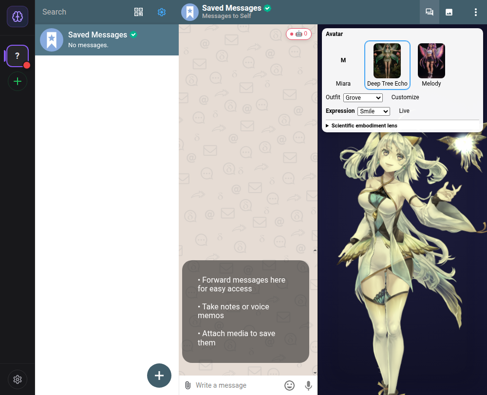

# PR92 final authority review

This follow-up closes four concrete integration issues found while preparing PR92 for review. It does not merge the PR, resume Cloudflare implementation, or replace canonical DTE identity, DAO votes, ESN learning or scientific reasoning with presentation logic.

## Policy precedence and exact outbound target

The orchestrator now preserves caller `autonomyBridge` policy, including a disabled autonomous response, a custom coherence threshold and a custom cooldown. Only the process-local proactive grant and exact account/chat target are forced by the orchestrator. Bridge defaults still fill omitted settings.

Target availability now uses `getChat(accountId, chatId)` directly. Lookup failure, returned-ID mismatch and `canSend !== true` fail closed. It no longer scans every account/chat. Authorization is checked before proposing and again before dispatch; concurrent checks remain serialized.

If an already-authorized send succeeds after its grant is revoked while the RPC is in flight, delivery accounting and cooldown are retained on the dispatching bridge. This is accounting for a completed operation, not permission to issue a new RPC. A deferred-send regression verifies revoke/re-enable does not erase the completed-send cooldown.

## A manual face is not a daemon authority lease

The display and React wrapper no longer suppress cognitive authority updates when a named expression is selected. `presentationLocked` is passed separately to the avatar manager. The manager continues ingesting or revoking canonical core-self and metabolic evidence, but suppresses composed face/parameter writes and pending self-model samples during the manual override. Scientific afterglow/cascade overlays are cleared; disposal resets the presentation gate. Unlocking returns to genuine live projection.

Tests cover the manager, React wrapper and display independently. The display test starts with a live daemon projection, locks Smile and then returns null from the daemon broker. The lock remains selected while core-self and metabolic projection disappear. The manager regression confirms no automatic parameter/expression writes or manual-pose training occur under the lock.

## Actual Electron observation

The rebuilt Electron app used the existing isolated persistent `DC_TEST_DIR` profile and its local Saved Messages chat. A real private daemon ran with in-memory cognition, no inherited connector credentials, every remote integration disabled, message processing disabled and proactive delivery off. No remote registration or outbound message was performed.

The mounted DTE identity had a real 347 × 762 Cubism canvas. A committed-React-tree read-only probe verified initialized core self with the daemon live; the actual Smile selector was then locked. After SIGTERM stopped the socket-owning daemon, the same still-open manager retained its manual lock while `coreSelfInitialized`, `hasMetabolicEvidence` and pending cognitive sampling were all false. Scientific genius and ESN visual fields were zero, and no predictive crystal was fabricated. The selector was restored to Live after capture.

This screenshot shows the existing DTE/Miara-derived Cubism runtime. The new reference-derived PSD and 3D facial assets are separate authoring outputs, not a newly loaded DTE `.moc3`. Linux sandbox/SwiftShader results are not Windows hardware performance evidence.

## Validation and merge gate

`pnpm check`, the complete workspace tests, `pnpm build:orchestrator` and `pnpm build:electron` passed. The workspace run reports 1,994 passed tests and two existing skips. Focused manager coverage passed 45 tests, frontend wrapper/display coverage passed 43 tests and proactive outbound coverage passed 19 tests. The real private-daemon/Electron locked-revocation regression passed.

Browser E2E is running against the same reviewed source. Fresh GitHub checks must be verified on the pushed follow-up SHA; the prior head's green checks cannot be reused. No merge has been performed.
